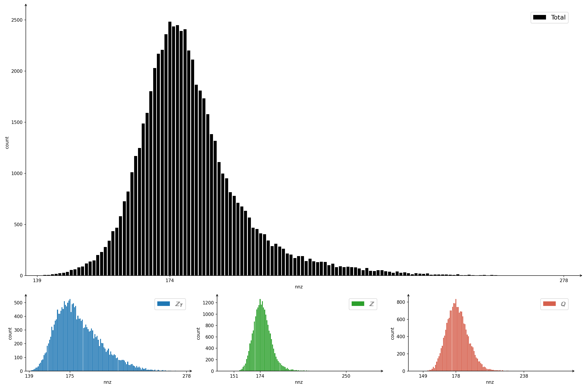
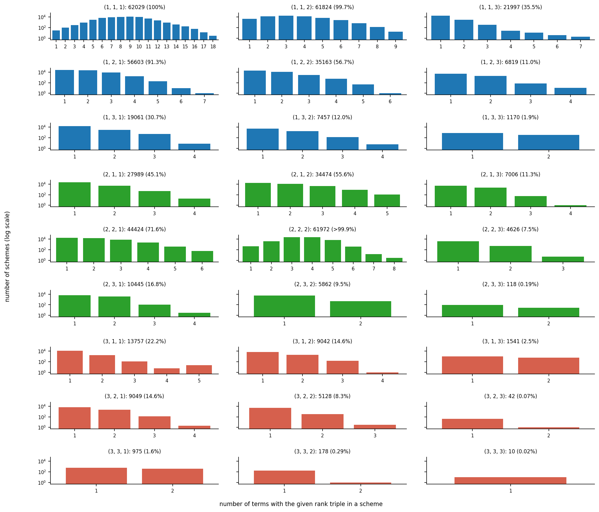

# So Many Ways to Multiply 3x3 Matrices: A Large Dataset of Rank-23 Schemes

A dataset of rank-23 schemes for 3x3 matrix multiplication, accompanying the paper *So Many Ways to Multiply 3×3 Matrices: A Large Dataset of Rank-23 
Schemes*.

The dataset currently contains **62029 schemes**, one for every rank pattern found, so no two schemes of the dataset are equivalent. The coefficients are 
ternary (`ZT`, values in {-1, 0, 1}), integer (`Z`) or rational (`Q`). Each scheme is stored in three formats: JSON, plain text and Maple.

## Sparsity of the schemes

The histograms below show the distribution of the number of nonzero coefficients (`nnz`) in the matrices `U`, `V`, `W`. The top histogram covers all schemes 
of the dataset, and the three histograms under it show the schemes of each coefficient class separately: ternary (`ZT`), integer (`Z`) and rational (`Q`). 
The ticks on the horizontal axes mark the minimum, the mode and the maximum of each distribution. The vertical scales of the histograms differ.

<p align="center">
  
</p>

## Rank triples

Every term of a scheme has a triple of ranks `(r_u, r_v, r_w)` with entries from {1, 2, 3}, so there are 27 possible triples, and the rank pattern of a 
scheme is determined by the number of terms with each of them. The figure below shows, for each of the 27 triples, the distribution over the dataset of the 
number of terms of a scheme that have this triple (the horizontal axis); the vertical axis (logarithmic) is the number of schemes. The percentage in the 
title of a panel is the share of schemes that contain the triple at least once, and schemes without it are not shown. The colors correspond to `r_u`. 
Reading the panels row by row gives the letters `a`, `b`, …, `A` of the `rle` encoding (see below).

The panels are not symmetric with respect to permutations of a triple, since the order of the factors of every scheme is chosen so that its rank pattern is 
lexicographically smallest.

<p align="center">
  
</p>

## Repository structure

```
├── schemes/
│   └── <rank pattern>/       # directory named by the pattern
│       ├── <filename>.json
│       ├── <filename>.m
│       └── <filename>.txt
├── figures/
│   ├── complexities.png      # distribution of the number of nonzero coefficients
│   └── rank_triples.png      # distribution of the number of terms with each rank triple
├── dataset.json              # index of the dataset, one entry per rank pattern
├── verify.py                 # verification script (Python 3, standard library only)
└── LICENSE
```

Files are named `3x3x3_m23_<hash>_<class>.<ext>`, where `<hash>` is the hash of the scheme, `<class>` is the coefficient class (`ZT`, `Z` or `Q`) and 
`<ext>` is `json`, `m` or `txt`.

## Index: `dataset.json`

`dataset.json` is a single JSON object with one entry per rank pattern (in the file, each entry occupies one line). The keys are the rank patterns written 
as polynomials `type(x,y,z)`: the monomial `c·x^i y^j z^k` means that `c` terms of the scheme have ranks `i`, `j`, `k` in the three factors. An entry looks 
as follows:

```json
{
    "x^3y^3z^3+4x^2y^2z^2+2xy^2z+2xyz^2+14xyz": {
        "filename": "3x3x3_m23_44cf54abf5dfcd3b2f3d15ec8b1122ee106d07b9_Z",
        "ring": "Z",
        "nnz": 188,
        "rle": "14a2b2d4nA",
        "f(x,y,z)": "6x^3y^3z^3 + 24x^2y^2z^2 + 8x^2yz + 8xy^2z + 8xyz^2 + 84xyz",
        "g(w)": "2w^31 + w^29"
    },
    ...
}
```

| Field              | Meaning                                                                                                                                                                           |
|--------------------|-----------------------------------------------------------------------------------------------------------------------------------------------------------------------------------|
| `filename`         | Name of the scheme files (without extension)                                                                                                                                      |
| `ring`             | Coefficient class: `ZT`, `Z` or `Q`                                                                                                                                               |
| `nnz`              | Number of nonzero coefficients in `U`, `V`, `W`                                                                                                                                   |
| `rle`              | The rank pattern in the compact run-length encoding of the [collection of Heule, Kauers and Seidl](http://www.algebra.uni-linz.ac.at/research/matrix-multiplication/) (see below) |
| `f(x,y,z)`, `g(w)` | Invariants of the scheme used to distinguish schemes                                                                                                                              |

**The `rle` string.** Each term of a scheme has a triple of ranks `(r_u, r_v, r_w)` of its three factors, and each of the 27 possible triples is assigned a 
letter in the lexicographic order: `a` = (1,1,1), `b` = (1,1,2), `c` = (1,1,3), `d` = (1,2,1), …, `z` = (3,3,2), `A` = (3,3,3). A rank pattern is the string 
of the 23 letters of its terms, and runs of equal letters are shortened by a multiplicity prefix (omitted for runs of length one). In the example above, 
`14a2b2d4nA` stands for `aaaaaaaaaaaaaabbddnnnnA`, which corresponds term by term to the key: `14a` is `14xyz`, `2b` is `2xyz^2`, `2d` is `2xy^2z`, `4n` is 
`4x^2y^2z^2` and `A` is `x^3y^3z^3`.

## Scheme formats

A scheme is a triple of matrices `U`, `V`, `W` with 23 rows and 9 columns each, written in the transposed encoding of `W` used in the paper (and in most 
catalogs of schemes). Row `l` of `U`, `V`, `W` describes the `l`-th term, and the 9 entries of a row are the entries of a 3x3 matrix in the row-major order.

**JSON** (`.json`): the keys are `dimension`, `rank`, `nnz`, the matrices `u`, `v`, `w` as lists of rows, and the invariants `type`, `f(x,y,z)`, `g(w)`. 
Rational coefficients are written as strings, e.g. `"-1/2"`.

**Plain text** (`.txt`): the header line `3 3 3 23`, followed by three lines with the flattened matrices `U`, `V` and `W`. In schemes of class `Q` every 
coefficient is written as a pair of numbers, the numerator and the denominator (`-1 2` stands for -1/2 and `1 1` for 1).

**Maple** (`.m`): for every term, the three 3x3 matrices of its factors are written as nested lists in curly braces. Rational coefficients are written as 
`-1/2`.

## Verification

```bash
python verify.py
```

The script loads every scheme of the dataset in all three formats and checks that it is a correct scheme, i.e. that it satisfies the Brent equations. It 
requires only Python 3 and the standard library.

## Related repositories

- [FastMatrixMultiplication](https://github.com/dronperminov/FastMatrixMultiplication): main fast matrix multiplication research repository.
- [ternary_flip_graph](https://github.com/dronperminov/ternary_flip_graph): the flip graph search framework.
- [numerical-fast-matmul](https://github.com/dronperminov/numerical-fast-matmul): the GradALS method (gradient descent with alternating least squares).

## Citation

If you use the dataset, please cite the paper:

```bibtex
@article{perminov2026rank23dataset,
  author = {Perminov, Andrew},
  title  = {So Many Ways to Multiply $3\times3$ Matrices: A Large Dataset of Rank-23 Schemes},
  journal={arXiv preprint arXiv:TODO},
  url={https://arxiv.org/abs/TODO},
  year={2026}
}
```

## License

This repository is released under the [MIT License](LICENSE).
